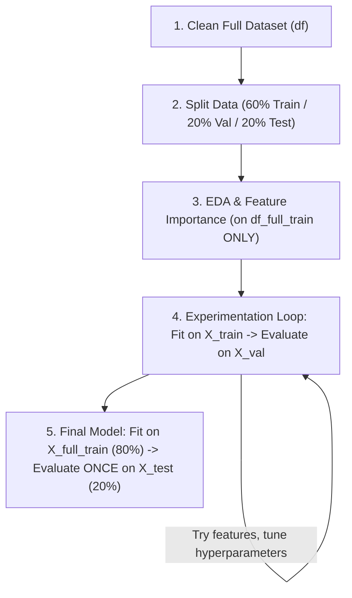

# Module 3: Classification & End-to-End Supervised ML Methodology

This guide documents the **step-by-step Supervised Machine Learning workflow** so you can code every project from scratch by hand without losing track of data splits, encoders, or evaluation sets.

---

## 🧭 High-Level Workflow (The Golden Rule)



> [!IMPORTANT]
> **Three Golden Rules to Remember:**
> 1. **Never touch `df_test` / `X_test` until Step 5.** All feature engineering, feature selection, and hyperparameter tuning decisions are evaluated on **`X_val` / `y_val`**.
> 2. **`fit_transform()` is ONLY for training data (`df_train` or `df_full_train`).** Validation (`df_val`) and Test (`df_test`) must **always** use `.transform()` only.
> 3. **Use distinct variable names for Validation vs. Test predictions** (e.g., `y_pred_val` vs. `y_pred_test`)—because `y_val` and `y_test` have the exact same length (`20%`), reusing `y_pred` or `churn_decision` can silently compare test predictions against validation labels!

---

## 🛠️ Step-by-Step Hands-On Checklist

### Step 1: Data Cleaning & Standardization (on `df`)
Before splitting, make column names, string values, numeric types, and target values consistent:

```python
# 1. Standardize column names
df.columns = df.columns.str.lower().str.replace(' ', '_')

# 2. Standardize string values in categorical columns
categorical_columns = list(df.dtypes[df.dtypes == 'object'].index) # or 'str'
for c in categorical_columns:
    df[c] = df[c].str.lower().str.replace(' ', '_')

# 3. Fix numeric columns that were parsed as strings and fill missing values
df.totalcharges = pd.to_numeric(df.totalcharges, errors='coerce').fillna(0)

# 4. Convert target variable to binary integer (0 / 1)
df.churn = (df.churn == 'yes').astype(int)
```

---

### Step 2: Validation Framework — The 60 / 20 / 20 Split
Split the dataset in **two stages** using `train_test_split`:
1. First, hold out **20% for `df_test`**, leaving **80% in `df_full_train`**.
2. Next, split `df_full_train` so that **25% of 80% (= 20% of total)** becomes `df_val`, leaving **60% in `df_train`**.

```python
from sklearn.model_selection import train_test_split

# Split 1: 80% full_train, 20% test
df_full_train, df_test = train_test_split(df, test_size=0.2, random_state=1)

# Split 2: 75% of 80% = 60% train, 25% of 80% = 20% val
df_train, df_val = train_test_split(df_full_train, test_size=0.25, random_state=1)

# Reset indices cleanly
df_train = df_train.reset_index(drop=True)
df_val = df_val.reset_index(drop=True)
df_test = df_test.reset_index(drop=True)
df_full_train = df_full_train.reset_index(drop=True)

# Extract target arrays (y)
y_train = df_train.churn.values
y_val = df_val.churn.values
y_test = df_test.churn.values
y_full_train = df_full_train.churn.values

# Remove target column from feature dataframes (keep it in df_full_train for EDA)
del df_train['churn']
del df_val['churn']
del df_test['churn']
```

---

### Step 3: Exploratory Data Analysis & Feature Importance (on `df_full_train`)
Use `df_full_train` (never `df_test`) to inspect:
* **Global target mean** (`df_full_train.churn.mean()`) and class balance.
* **Define feature lists**:
  * `numerical = ['tenure', 'monthlycharges', 'totalcharges']`
  * `categorical = [...]` (remember to exclude ID columns like `customerid`!).
* **Categorical importance**:
  * **Risk ratio**: `group_churn / global_churn`
  * **Mutual Information**: `df_full_train[categorical].apply(lambda s: mutual_info_score(s, df_full_train.churn))`
* **Numerical importance**:
  * **Correlation**: `df_full_train[numerical].corrwith(df_full_train.churn).abs()`

---

### Step 4: The Experimentation & Tuning Loop (`X_train` → `X_val`)
During model development, feature engineering, and hyperparameter tuning:
* **Fit** the encoder (`DictVectorizer`) and model on **`df_train` / `y_train`**.
* **Transform and evaluate** on **`df_val` / `y_val`**.

```python
from sklearn.feature_extraction import DictVectorizer
from sklearn.linear_model import LogisticRegression

# 1. Fit vectorizer on TRAIN only
dv = DictVectorizer(sparse=False)
train_dict = df_train[categorical + numerical].to_dict(orient='records')
X_train = dv.fit_transform(train_dict)

# 2. Transform VAL using the already-fitted vectorizer
val_dict = df_val[categorical + numerical].to_dict(orient='records')
X_val = dv.transform(val_dict)

# 3. Train model on X_train, y_train
model = LogisticRegression(solver='lbfgs', max_iter=2000, random_state=1)
model.fit(X_train, y_train)

# 4. Predict on X_val and evaluate against y_val
y_pred_val = model.predict_proba(X_val)[:, 1]
churn_decision_val = (y_pred_val >= 0.5)
val_accuracy = (y_val == churn_decision_val).mean()
print("Validation Accuracy:", val_accuracy)
```

*Repeat Step 4 whenever you add/remove features, adjust thresholds, or tune hyperparameters (like `C`). Always compare against `val_accuracy`.*

---

### Step 5: Final Model Training & Test Evaluation (`X_full_train` → `X_test`)
Once you have locked in your features and hyperparameters:
1. Retrain a fresh `DictVectorizer` and `LogisticRegression` on **`df_full_train` (80% of data)**.
2. Evaluate **once** on the held-out **`df_test` / `y_test` (20% of data)** to verify that validation performance generalizes.

```python
# 1. Fit a fresh vectorizer on FULL TRAIN (train + val)
dv_final = DictVectorizer(sparse=False)
dicts_full_train = df_full_train[categorical + numerical].to_dict(orient='records')
X_full_train = dv_final.fit_transform(dicts_full_train)

# 2. Train final model on X_full_train, y_full_train
model_final = LogisticRegression(solver='lbfgs', max_iter=2000, random_state=1)
model_final.fit(X_full_train, y_full_train)

# 3. Transform TEST set using dv_final.transform()
dicts_test = df_test[categorical + numerical].to_dict(orient='records')
X_test = dv_final.transform(dicts_test)

# 4. Predict on X_test and evaluate against y_test
y_pred_test = model_final.predict_proba(X_test)[:, 1]
churn_decision_test = (y_pred_test >= 0.5)
test_accuracy = (y_test == churn_decision_test).mean()
print("Test Accuracy:", test_accuracy)
```

---

### Step 6: Scoring a Single New Customer (Inference)
To score an individual customer dictionary in production:
1. Wrap the single dictionary in a list `[customer]`.
2. Call `dv_final.transform([customer])` (never `fit_transform`).
3. Call `model_final.predict_proba(...)[0, 1]`.

```python
customer = dicts_test[-1]
X_customer = dv_final.transform([customer])
prob_churn = model_final.predict_proba(X_customer)[0, 1]
print(f"Churn probability: {prob_churn:.3f} -> Churn? {prob_churn >= 0.5}")
```

---

## ⚠️ Common Pitfalls When Coding by Hand

| Pitfall | Symptom | Fix |
| :--- | :--- | :--- |
| Reusing `churn_decision` / `y_pred` across `val` and `test` | Accuracy suddenly drops from `~0.803` to `~0.616` when comparing `y_val == churn_decision` | Name variables explicitly: `y_pred_val` / `churn_decision_val` vs. `y_pred_test` / `churn_decision_test` |
| Calling `dv.fit_transform(val_dict)` instead of `dv.transform(val_dict)` | Shape mismatch error or scrambled feature columns on validation/test | Only call `.fit_transform()` on training data; always call `.transform()` on `val`, `test`, or single customers |
| Leaving `customerid` in `categorical` | Thousands of one-hot columns (`X_train.shape` explodes to 4000+ columns) | Explicitly list `categorical` columns without ID columns |
| Tuning features/hyperparameters using `X_test` | Overfitting to the test set (optimistic test score) | Tune everything on `X_val`; only run `X_test` once at the very end |
